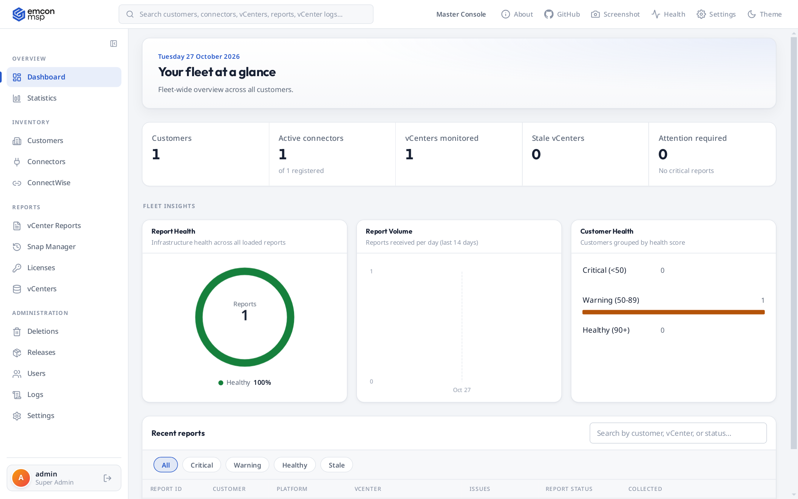
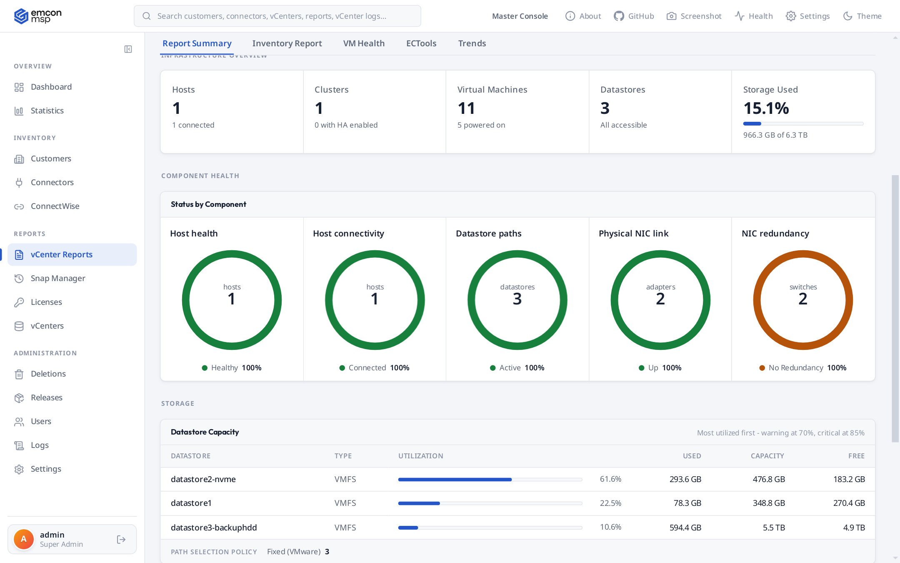
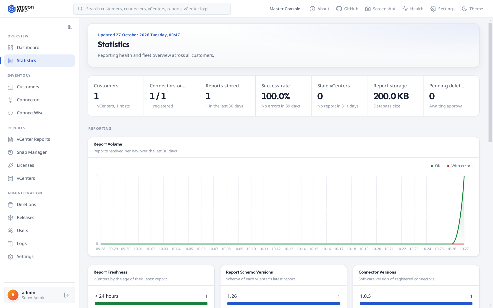
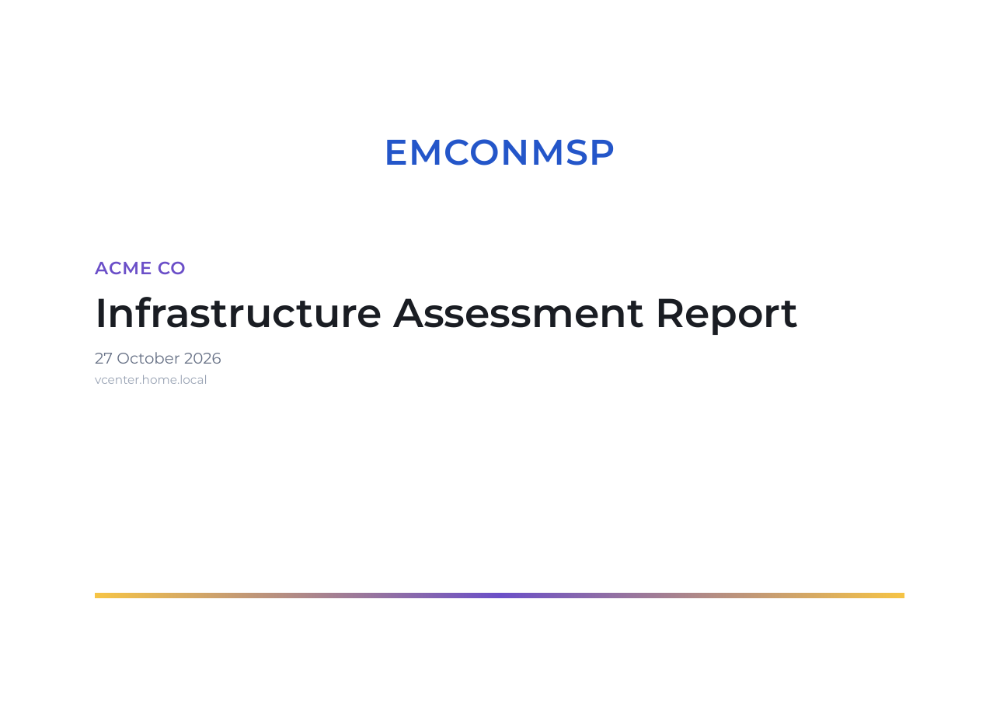
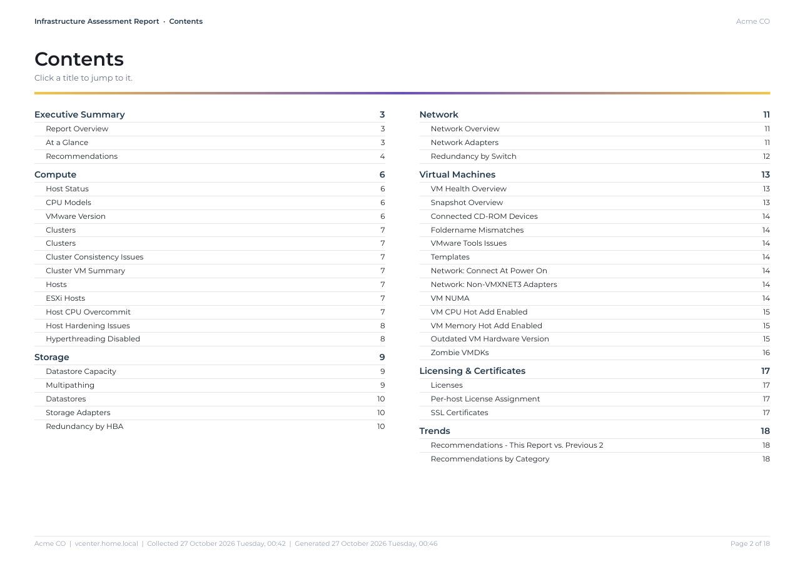
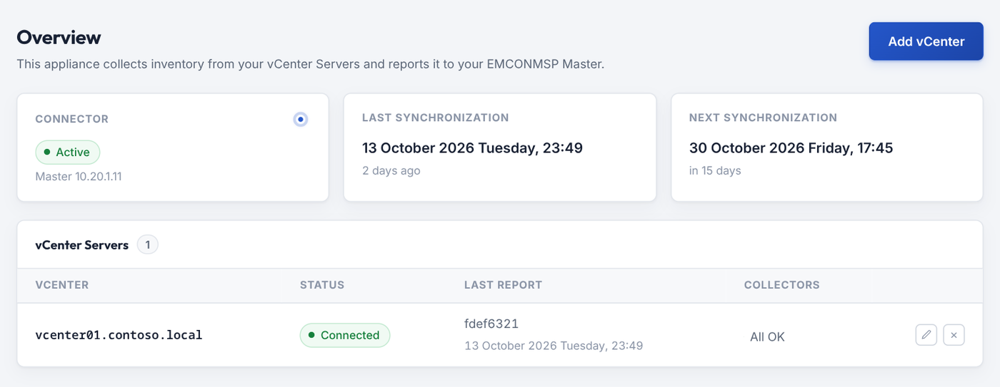

<div align="center">

# EMCONMSP

**VMware infrastructure monitoring and reporting platform for managed service providers**

[](#release-notes)
[](#release-notes)
[](#requirements)
[](#deployment)
[](#security)
[](#license)

[Overview](#overview) · [Capabilities](#capabilities) · [Architecture](#architecture) · [Deployment](#deployment) · [Security](#security) · [Release notes](#release-notes)



</div>

---

## Overview

EMCONMSP gives MSPs a single console for the health of every customer's VMware estate. A lightweight **Connector** appliance runs at each customer site and sends read-only inventory, health, log and snapshot data to the central **Master**, which turns it into findings, dashboards, branded PDF reports and email digests.

> This repository contains product documentation. EMCONMSP is delivered as virtual appliances (OVA).

## Capabilities

| Area | What you get |
| --- | --- |
| **Assessment reports** | Scheduled vCenter reports with severity-ranked recommendations (C1, W1...), inventory, VM health and trends across reports. |
| **Branded PDF** | Cover page, clickable table of contents and your own MSP logo and name, in the browser and in customer emails. |
| **Fleet insight** | Dashboard and Statistics with report volume, freshness, version spread and hardware vendors across all customers. |
| **Snap Manager** | Daily snapshot scan with creator tracking, exclusion rules by name, age and VM state, and team and customer digests. |
| **Log Viewer** | vCenter tasks and events every 15 minutes, with quick filters for common events such as HA restarts. |
| **Notifications** | SMTP relay with automatic retries, Microsoft Teams alerts, and a Zabbix-ready mail health endpoint. |
| **Integrations** | Read-only Integration API, ConnectWise Manage agreement checks and Active Directory sign-in. |
| **Administration** | Role-based access, enforced or optional MFA, user management, retention policies and appliance health. |

<table>
  <tr>
    <td width="50%"></td>
    <td width="50%"></td>
  </tr>
  <tr>
    <td align="center"><sub>Report summary with component health</sub></td>
    <td align="center"><sub>Fleet statistics</sub></td>
  </tr>
  <tr>
    <td></td>
    <td></td>
  </tr>
  <tr>
    <td align="center"><sub>Branded PDF report</sub></td>
    <td align="center"><sub>Clickable table of contents</sub></td>
  </tr>
</table>

## Architecture

```
 Customer site                         MSP
 +---------------------+              +------------------+      +--------------------+
 | vCenter             |  HTTPS out   |                  | ---> | Email / Teams      |
 |   ^ read-only API   | -----------> |      Master      | ---> | Integration API    |
 | Connector appliance |              |                  | ---> | Zabbix, ConnectWise|
 +---------------------+              +------------------+      +--------------------+
```

| Data stream | Frequency | Feeds |
| --- | --- | --- |
| vCenter report | Daily, weekly or monthly per customer | Reports, recommendations, PDF |
| Tasks and events | Every 15 minutes | Log Viewer |
| Snapshot scan | Daily | Snap Manager |

<p align="center"><br><sub>Connector appliance with live data flow status</sub></p>

## Deployment

1. **Master** - deploy the OVA, set IP, gateway, DNS and FQDN in *Customize template*, then sign in at `https://<master>` and change the initial password.
2. **Customer** - on the Master, create the customer with the Appliance ID of its Connector to receive a one-time activation code.
3. **Connector** - deploy the OVA at the customer site, enter the Master URL and activation code, and add the vCenter.

The Master is updated with release packages; Connectors receive their updates from the Master through **Releases**.

## Requirements

| Item | Requirement |
| --- | --- |
| vCenter | vSphere 7.x or 8.x |
| Service account | Read-only role plus *Global > Licenses*, *Datastore > Browse datastore* and *Host > Configuration > Change settings*, assigned on the vCenter root |
| Network | Outbound HTTPS from Connector to Master; no inbound rules at the customer |

## Security

- Read-only, least-privilege access to vCenter. Nothing is changed in the customer environment.
- vCenter credentials are encrypted on the Connector and never leave the site.
- Outbound-only communication over TLS.
- Role-based access with MFA, AD integration and session timeouts.
- Secrets at rest are encrypted. Designed for closed networks without internet access.

## Release notes

| Version | Highlights |
| --- | --- |
| **Master 1.0.12** | Report Volume chart fix when no failed reports exist. |
| **Master 1.0.11** | Modern charts across Dashboard, Statistics and Report Summary, unified stat cards, collapsible VMs in Snap Manager, PDF layout fix for large environments. |
| **Master 1.0.10** | Redesigned PDF with cover page and clickable contents, MSP logo and email name under Settings > Reports, VMware version and HBA redundancy sections. |
| **Master 1.0.9** | Snap Manager rules by snapshot age and VM state, Log Viewer quick filters, Zabbix mail monitoring, user edit and password reset. |
| **Connector 1.0.5** | Real event types for EventEx events, web server reliability fixes. |

## License

EMCONMSP is proprietary software. The license agreement is presented during OVA deployment and must be accepted before use.

<div align="center">
<sub>&copy; PilotHosts Software and Technology Limited Company · A <a href="https://www.pilothosts.com/">Pilothosts Tech</a> product</sub>
</div>
