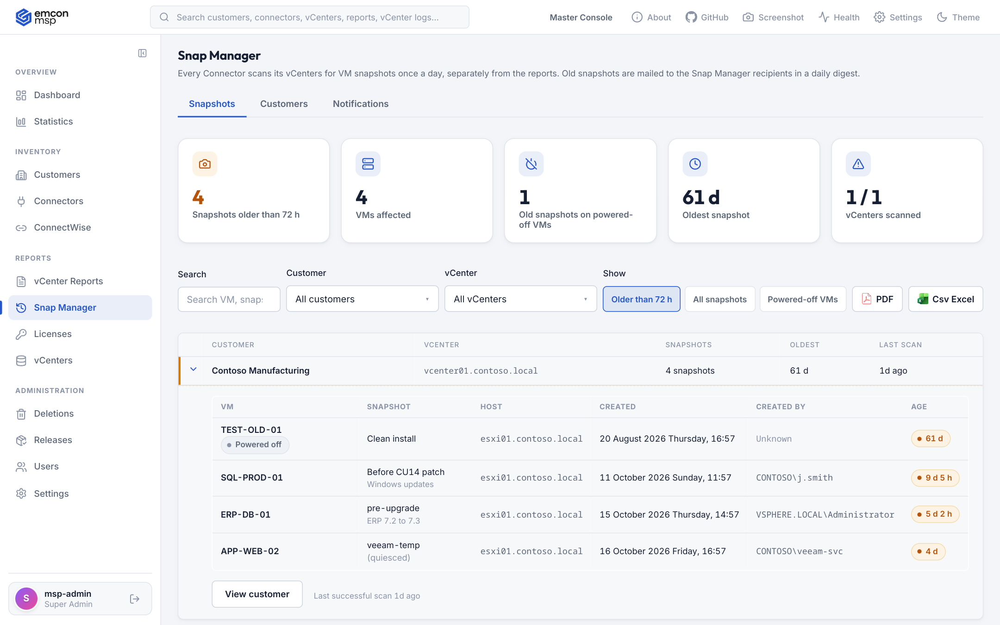
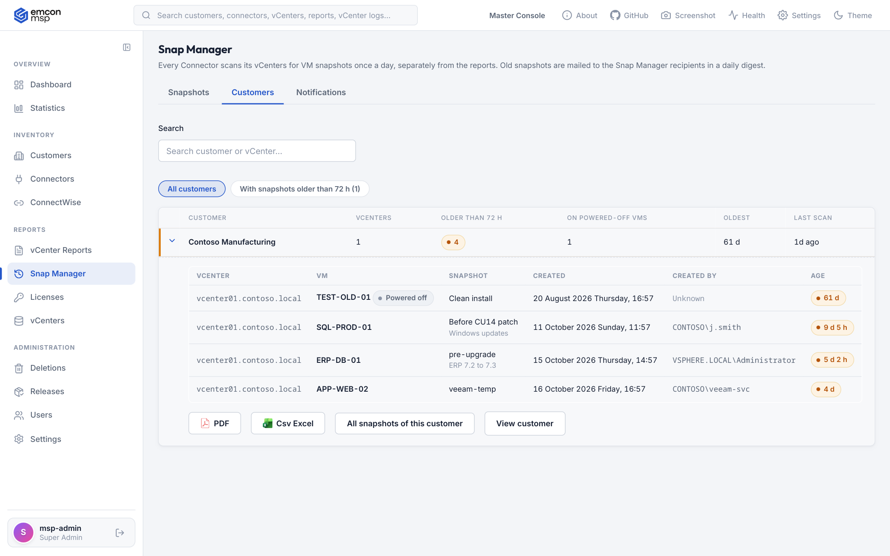
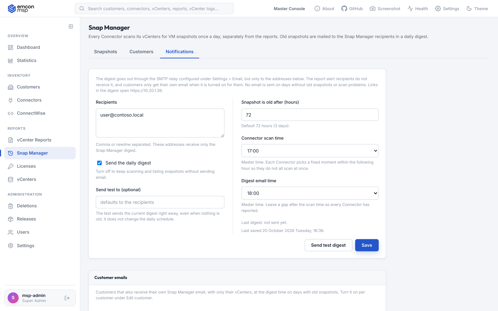
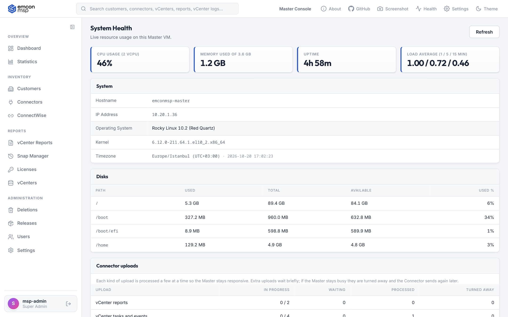
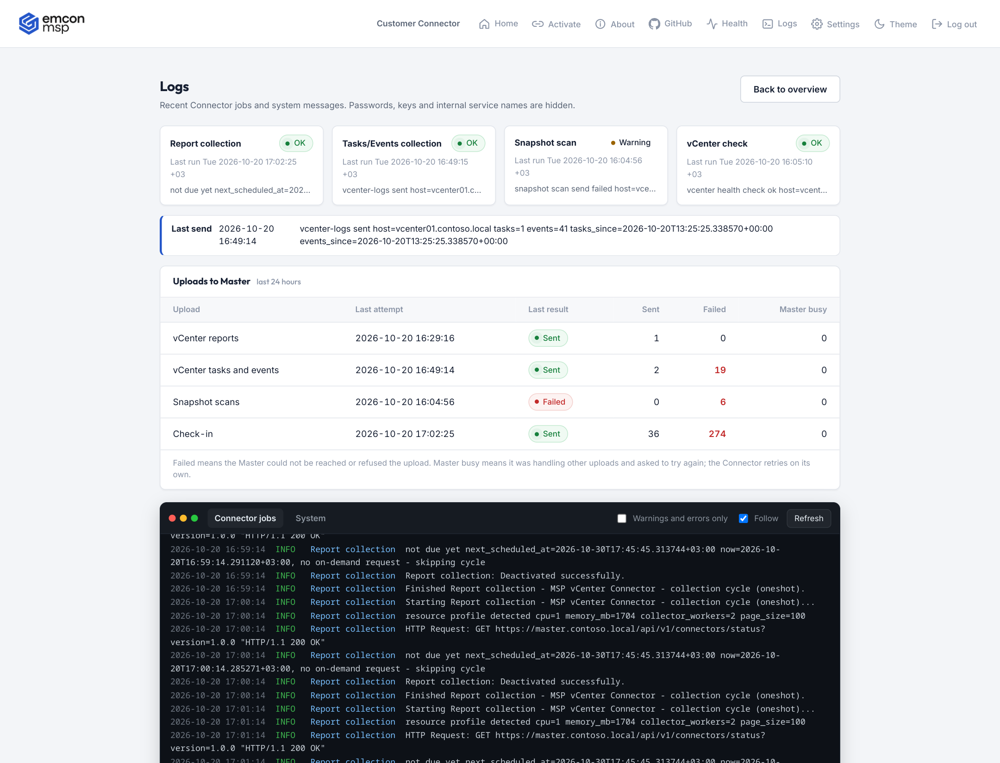
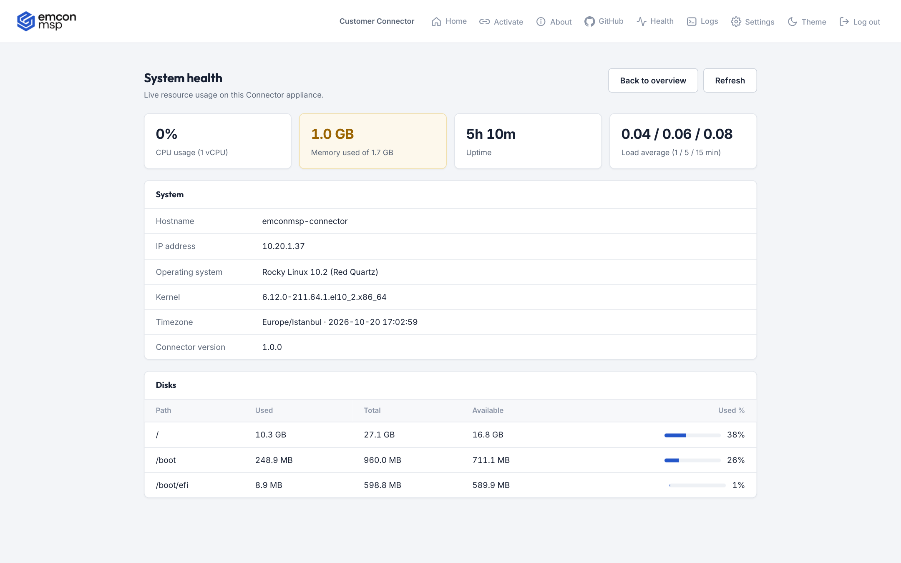

# EMCONMSP

**VMware infrastructure monitoring and reporting for managed service providers.**

EMCONMSP lets an MSP watch the health of every customer's VMware environment from one console. A small appliance (the **Connector**) runs next to each customer's vCenter and sends read-only inventory, health, log and snapshot data to your central **Master**. The Master turns it into dashboards, findings, PDF reports and email digests.

- Read-only toward vCenter. Nothing is ever changed in the customer's environment.
- Outbound only. Connectors call the Master over HTTPS; no inbound firewall rules are needed at the customer.
- vCenter credentials stay on the Connector, encrypted. They are never sent to the Master.
- Both products ship as ready-to-deploy virtual appliances (OVA) and work in closed networks.

> This repository only holds documentation. The product is delivered as OVA appliances.


---

## Contents

- [How it fits together](#how-it-fits-together)
- [Getting started](#getting-started)
- [Using the Master](#using-the-master)
- [Using the Connector](#using-the-connector)
- [Security at a glance](#security-at-a-glance)

---

## How it fits together

```
 Customer site A                    Customer site B
 +-----------------+                +-----------------+
 | vCenter(s)      |                | vCenter(s)      |
 |      ^          |                |      ^          |
 |  read-only API  |                |  read-only API  |
 |      |          |                |      |          |
 |  Connector      |                |  Connector      |
 +------+----------+                +------+----------+
        |  HTTPS (outbound only)           |
        +---------------+------------------+
                        v
                +---------------+        +-----------------+
                |    Master     | -----> | Email / Teams   |
                |  (your MSP)   |        | Integration API |
                +---------------+        +-----------------+
```

Each Connector sends three independent streams, each on its own schedule:

| Stream | How often | Used for |
| --- | --- | --- |
| vCenter report | Per customer schedule (daily, weekly or monthly) | Inventory, health findings, PDF reports |
| Tasks and events | Every 15 minutes | Log Viewer |
| Snapshot scan | Once a day | Snap Manager |

The Master processes uploads a few at a time and asks a Connector to retry later when it is busy, so a large fleet never overloads it.

---

## Getting started

### 1. Deploy the Master

1. Deploy the **EMCONMSP Master** OVA in vSphere.
2. In *Customize template*, fill in the **Network Configuration** section. Leave **IP Address** empty to use DHCP.

   | Field | Meaning |
   | --- | --- |
   | IP Address | Static IP for the appliance. Blank means DHCP. |
   | Network Prefix Length | Subnet prefix, for example `24`. |
   | Gateway | Default gateway. |
   | DNS Server | DNS server address. |
   | Hostname | FQDN of the Master. Also used for its TLS certificate and for links in emails. |

3. Power on the VM, open `https://<master-address>` and sign in. You must change the initial password first.

<p align="center"></p>

### 2. Deploy a Connector for each customer

1. Deploy the **EMCONMSP Connector** OVA next to the customer's vCenter, with the same network fields.
2. On the Master, create the customer (**Customers > New customer**) with the Appliance ID shown on the Connector. You get a one-time **activation code** and the **Master Server URL**.
3. Open `https://<connector-address>`, sign in, change the initial password and enter the Master Server URL and the activation code.
4. Add the customer's vCenter.

<p align="center"></p>

---

## Using the Master

### Customers and reports

Open a customer to see its connectors, vCenters, health score, latest reports, topology and report history. From here you can request a fresh report, re-issue the activation code and set the customer's email preferences.


Each report is a snapshot of one vCenter:

- **Report Summary** with overall health and **Recommendations** grouped by area. Findings are marked critical or warning.
- **Inventory Report** with hosts, clusters, networks, datastores, storage adapters, redundancy checks, licenses and certificates.
- **VM Health** with snapshots, VMware Tools, hot-add settings, outdated virtual hardware, unreferenced VMDKs and more.
- **Trends** to compare the latest reports of a vCenter.

A report can be downloaded as **PDF** (the same file customers receive by email), raw **JSON** or an **Excel** inventory export.


<details>
<summary>More report screenshots</summary>


</details>

### Snap Manager

Snap Manager watches for forgotten VM snapshots. Every Connector scans its vCenters once a day, separately from the reports, and also records **who created each snapshot** from the vCenter task history.

- **Snapshots**: every snapshot older than the threshold (72 hours by default), with summary cards, search, customer and vCenter filters, a powered-off view, and PDF and CSV export.
- **Customers**: one row per customer, most old snapshots first. Open a customer to see its snapshots and download a PDF or CSV for that customer only.
- **Notifications**: a daily digest for your team, sent through the SMTP relay to its own recipient list. The digest body holds the summary and a link per customer; the full list is attached as PDF and CSV. Scan and digest times and the threshold are set here.

Each customer can also receive its own daily Snap Manager email with only its vCenters, turned on per customer under **Edit customer**.



<details>
<summary>Customers and Notifications tabs</summary>





</details>

### Log Viewer

**Customer > Log Viewer** shows vCenter tasks and events collected every 15 minutes, with search, time ranges, state filters and expandable rows. Errors are highlighted.


### Fleet pages

| Page | Purpose |
| --- | --- |
| **Dashboard** | Customers that need attention, report health and recent activity. |
| **Statistics** | Fleet-wide numbers and trends. |
| **Customers** | All customers, with search. |
| **Connectors** | Every appliance with its online status and version. |
| **vCenter Reports** | Every report, filterable by customer, status and date. |
| **Snap Manager** | Old VM snapshots across all customers. |
| **Licenses** | Licenses per vCenter, most urgent first. |
| **vCenters** | Every monitored vCenter and whether it is in sync. |

Lists can be filtered by customer and vCenter with dropdowns you can type into, and exported to CSV.


### Email and notifications

**Settings > Email** configures the SMTP relay.

- Customers who opted in receive each new report as a PDF.
- **Alert recipients** (your own team) receive a copy of every report and report deletion requests.
- Failed emails are retried automatically, and the last result is shown in the settings.

**Settings > Teams** posts critical reports to a Microsoft Teams channel.

### Settings

Open **Settings** in the header or the sidebar.


| Section | Purpose |
| --- | --- |
| Change password / MFA | Your own password and authenticator app sign-in with recovery codes. |
| Network | The appliance IP, DNS and hostname. |
| Teams / Email | Notification channels. |
| Integration API | A read-only API key for ticketing tools. |
| Report retention / Log Viewer retention | How long reports and logs are kept. |

### System Health

**Health** in the header shows CPU, memory, uptime, disks and the **Connector uploads** queues: how many uploads of each kind are in progress, waiting or were turned away because the Master was busy.



### Users, roles and two-factor authentication

| Role | Access |
| --- | --- |
| Super Admin | Everything, including users, releases, email settings and report deletion approvals. |
| Admin | Customers, connectors, reports and settings. |
| Read Only | Customers, reports, vCenters, licenses and Snap Manager, without settings. |

- Anyone can turn on two-factor authentication. A user can also be required to set it up at first sign-in.
- A super admin can reset another user's two-factor authentication.

The header also has a search box with quick actions, a screenshot tool and a light/dark theme switch.

---

## Using the Connector

The Connector has a small local web interface at its own address. The header gives quick access to **Home**, **About**, **Health**, **Logs**, **Settings** and **Log out**.

### Overview

The overview shows the Connector state, the last and next synchronization, a live **data flow** diagram (vCenters, this Connector and the Master, with the state of each connection) and the list of vCenters.


### Add a vCenter

Use **Add vCenter** and enter the vCenter address and a service account. **Test connection** and **Save** check that the account really holds the privileges the Connector needs on the vCenter root, whatever its role is called. **What role is needed?** on the form lists the exact steps.


| Privilege | Used for |
| --- | --- |
| Read-only role (System > View, System > Read) | Browsing the inventory and reading configuration. |
| Global > Licenses | License editions, usage and expiry. |
| Datastore > Browse datastore | Finding unreferenced VMDK files. |
| Host > Configuration > Change settings | Reading host settings such as NTP, syslog and shell timeouts. |

Clone the Read-only role, add the three extra privileges and assign it to the account on the vCenter root with **Propagate to children**. A suggested role name is `EMCONMSP-Connector`.

### Logs

**Logs** shows the status of each Connector job, the last upload to the Master, a 24-hour summary of uploads (sent, failed, Master busy) and a terminal view of the job and system logs. Passwords, keys and internal service names are masked before they are shown.



### System Health

**Health** shows CPU, memory, uptime, load and disk usage of the appliance.



### Settings

**Settings** offers **Change password**, **Network settings** (IP, DNS, NTP) and **Delete all reports**, which sends a deletion request that a super admin on the Master must approve. Sessions end after 15 minutes without activity.

---

## Security at a glance

- Read-only access to vCenter with a dedicated least-privilege service account.
- vCenter credentials are encrypted on the Connector and never leave it.
- Connectors only make outbound HTTPS calls to the Master.
- Role-based access on the Master, with optional or enforced two-factor authentication.
- SMTP passwords are stored encrypted on the Master.
- Designed to work in closed networks without internet access.

## License

EMCONMSP is proprietary software. The license agreement is shown during OVA deployment and must be accepted before the appliance can be deployed.

&copy; PilotHosts Software and Technology Limited Company. A [Pilothosts Tech](https://www.pilothosts.com/) product.
