# EMCONMSP

**VMware infrastructure monitoring and reporting for managed service providers.**

EMCONMSP lets an MSP watch the health of every customer's VMware environment from one console. A small appliance (the **Connector**) sits next to each customer's vCenter and sends read-only inventory and health reports to your central **Master**. The Master turns them into dashboards, findings, PDF reports and emails.

- Read-only toward vCenter. Nothing is ever changed in the customer's environment.
- Outbound only. Connectors call the Master over HTTPS, no inbound firewall rules are needed at the customer.
- vCenter credentials stay on the Connector, encrypted. They are never sent to the Master.
- Both products ship as ready-to-deploy virtual appliances (OVA).

> This repository only holds documentation. The product is delivered as OVA appliances.


---

## How it fits together

```
 Customer site A                    Customer site B
 +-----------------+                +-----------------+
 | vCenter(s)      |                | vCenter(s)      |
 |      ^          |                |      ^          |
 |  read-only API   |                |  read-only API   |
 |      |          |                |      |          |
 |  Connector      |                |  Connector      |
 +------+----------+                +------+----------+
        |  HTTPS (outbound only)           |
        +---------------+------------------+
                        v
                +---------------+        +-----------------+
                |    Master     | -----> | Email / Teams   |
                |  (your MSP)   |        | ConnectWise     |
                +---------------+        | Integration API |
                                         +-----------------+
```

| Component | Where it runs | What it does |
| --- | --- | --- |
| **Connector** | One per customer environment | Connects to the customer's vCenter(s), collects inventory, health and task/event logs, and sends them to the Master. Has a small local web UI for setup. |
| **Master** | Your MSP | Receives reports from all Connectors, shows them per customer, raises findings, sends PDF reports and notifications. |

---

## Getting started

### 1. Deploy the Master

1. Deploy the **EMCONMSP Master** OVA in your vSphere environment.
2. In the *Customize template* step of the wizard, fill in the network section. Leave **IP Address** empty to use DHCP.

   | Field | Meaning |
   | --- | --- |
   | IP Address | Static IP for the appliance. Blank means DHCP. |
   | Network Prefix Length | Subnet prefix, for example `24`. |
   | Gateway | Default gateway. |
   | DNS Server | DNS server address. |
   | Hostname | FQDN of the Master. It is also used as the name on the TLS certificate. |

3. Power on the VM and open `https://<master-address>` in a browser.
4. Sign in. You are required to change the initial password before you can continue.

<p align="center">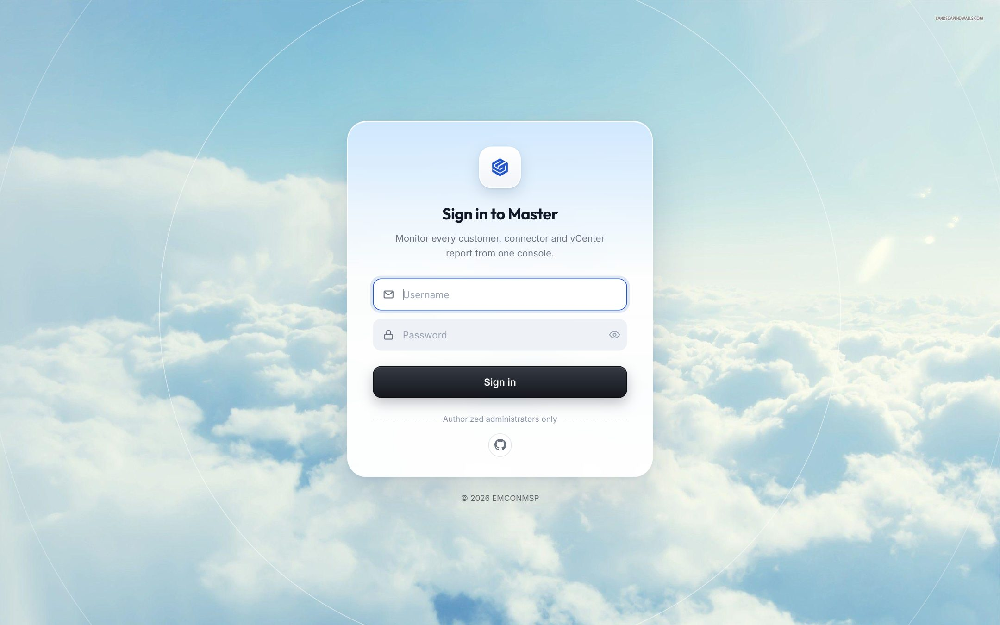</p>

### 2. Deploy a Connector for each customer

1. Deploy the **EMCONMSP Connector** OVA next to the customer's vCenter, with the same network fields as above.
2. Open `https://<connector-address>` and sign in. You are required to change the initial password.
3. Activate the Connector with a one-time code from the Master (see below).
4. Add the customer's vCenter.

<p align="center">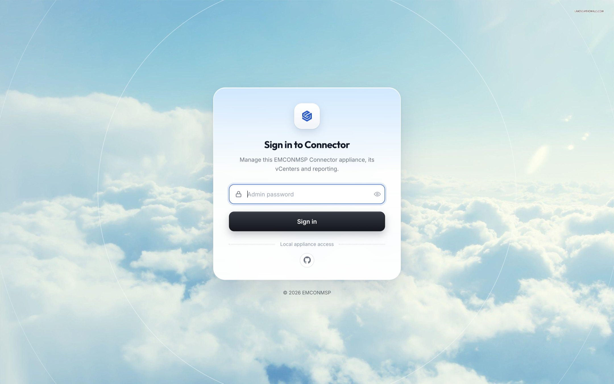</p>

---

## Using the Master

### Customers

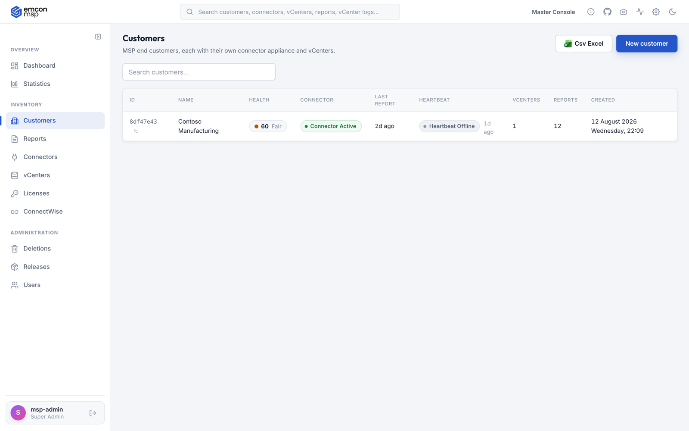

**Customers > New customer** creates the customer record.

- Enter the customer name and the **Appliance ID** shown on the Connector.
- Optionally add the customer's email addresses and tick *send reports to this customer* so every new report is emailed to them as a PDF.
- If ConnectWise is connected, you can pick the customer's company from a list instead of typing it.

Open the customer to see its connectors, vCenters, latest reports, topology, health score and report history. **Generate code** (or **Re-issue code**) creates the one-time activation code you enter on the Connector. **Request report** asks a Connector to send a fresh report right away. The header also shows at a glance whether report emails are on for the customer.

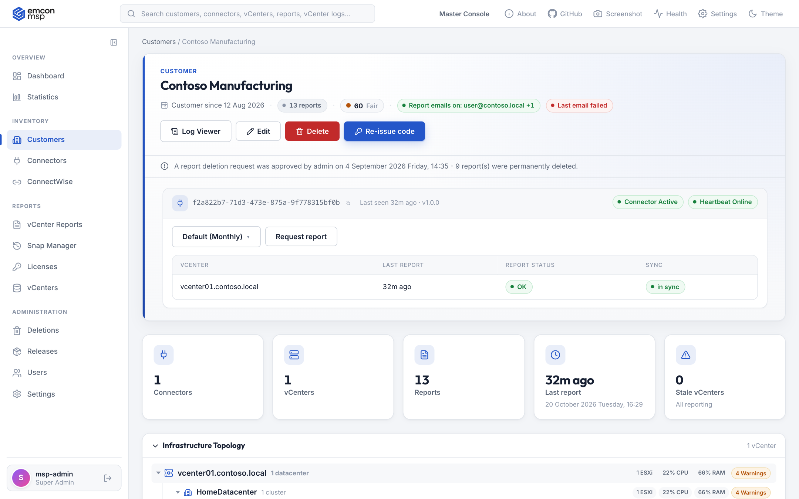

### Reports

Each report is a snapshot of one vCenter. A report contains:

- **Report summary** with overall health and **Recommendations** grouped by area (storage, VM, hosts, network, licenses and so on). Findings are marked critical or warning.
- **Inventory report** with hosts, clusters, networks, datastores, storage adapters, redundancy checks, licenses and certificates.
- **VM health** with snapshots, VMware Tools, hot-add settings, outdated virtual hardware, zombie VMDKs and more.
- **Trends** to compare the latest reports of a vCenter.

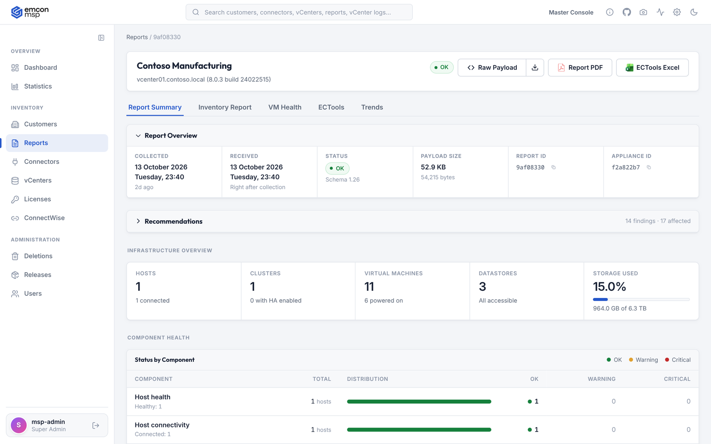

Recommendations explain what is wrong and which objects are affected:

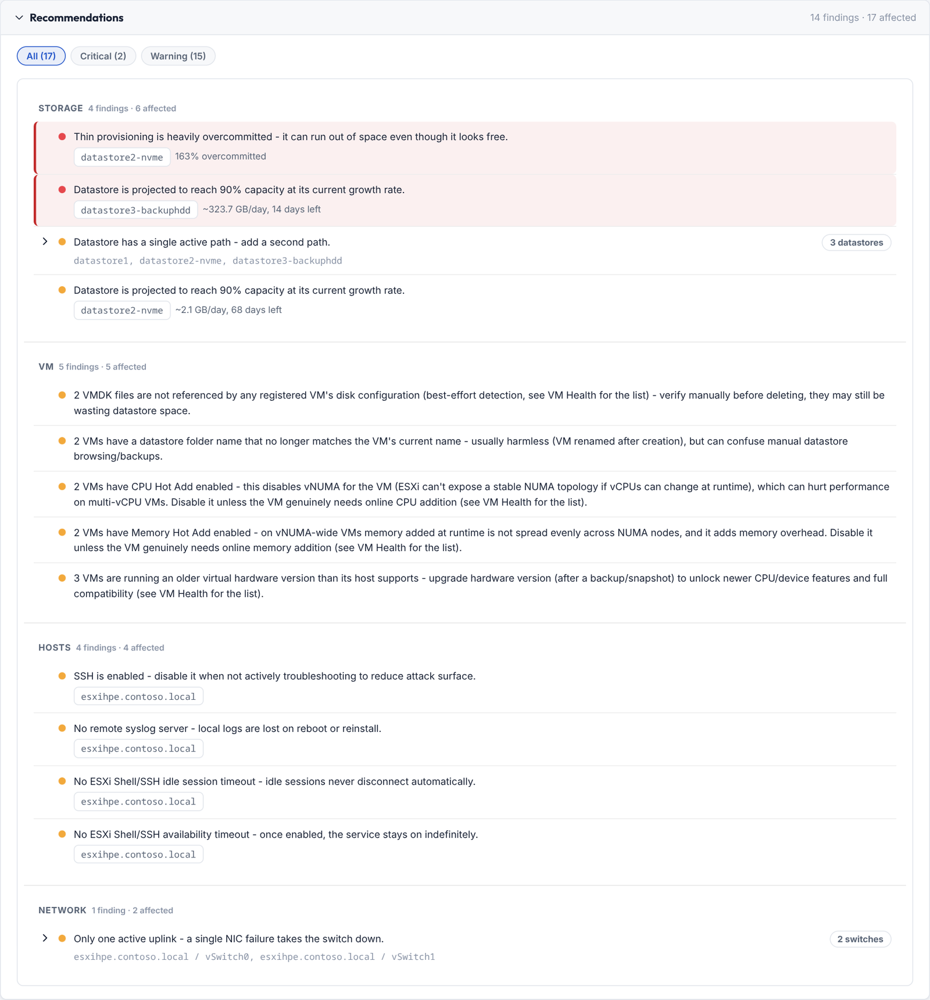

The inventory tab lists everything the Connector collected, with a short explanation under every section title:

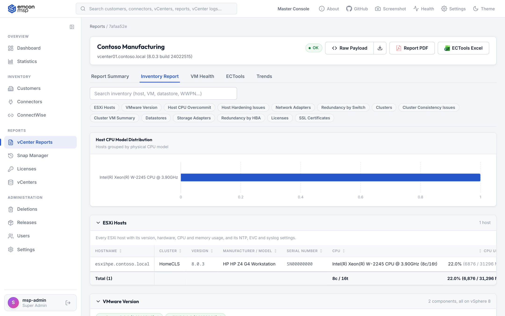

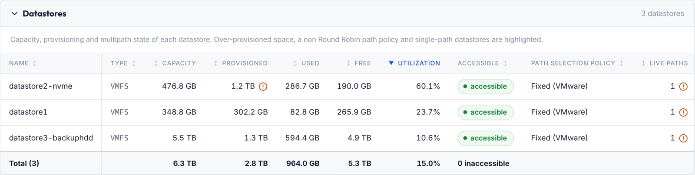

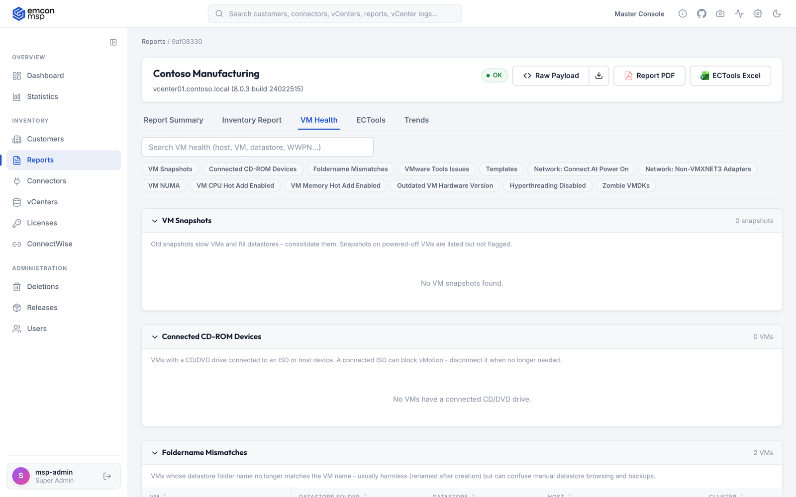

From a report you can download a **PDF** (the same file customers receive by email), the raw **JSON**, or an **Excel** inventory export.

### Email and notifications

**Settings > Email** configures your SMTP server.

- Customers who opted in receive each new report as a PDF.
- **Alert recipients** (your own team) receive a copy of every new report as a PDF, and report deletion requests.
- Each email includes the customer, vCenter, report ID, connector ID and a summary of findings.

**Settings > Teams** posts critical reports to a Microsoft Teams channel.

### Log viewer

**Customer > Log Viewer** shows vCenter tasks and events collected every 15 minutes, with search, time ranges, state filters and an expandable row for details. Errors are highlighted.

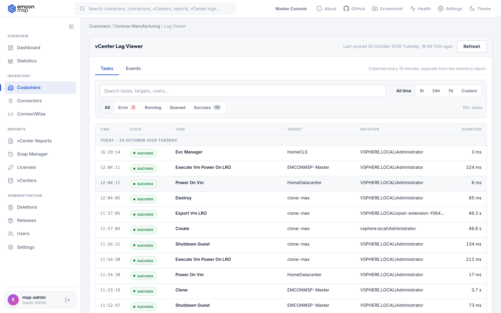

### Fleet pages

| Page | Purpose |
| --- | --- |
| **Dashboard** | Customers that need attention, report health, recent activity. |
| **Statistics** | Fleet-wide numbers and trends. |
| **Reports** | Every report, filterable by customer and status. |
| **Connectors** | All appliances with online status. |
| **vCenters** | Every monitored vCenter and whether it is in sync. Click a row for details. |
| **Licenses** | Licenses per vCenter, most urgent first. Click a vCenter to see its licenses. |
| **ConnectWise** | Read-only comparison of customer contracts against what is actually monitored. |

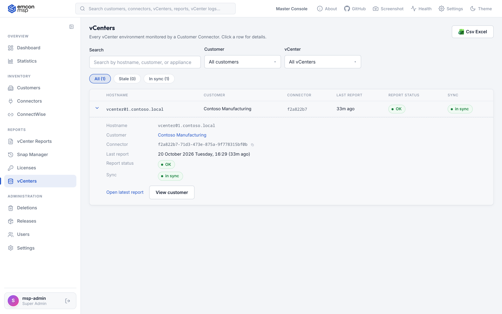

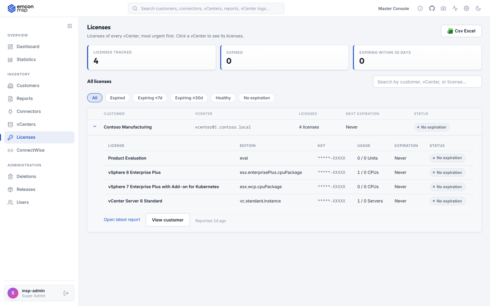

### Settings

Open the gear icon in the header.

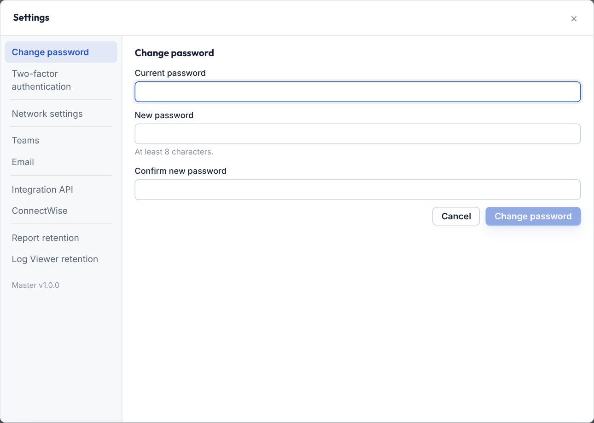

| Section | Purpose |
| --- | --- |
| Change password | Change your own password. |
| Two-factor authentication | Turn on authenticator-app (TOTP) sign-in and get recovery codes. |
| Network settings | Change the appliance IP, DNS and hostname. |
| Teams / Email | Notification channels described above. |
| Integration API | An API key that lets ticketing tools read reports. |
| ConnectWise | Read-only connection to ConnectWise Manage. |
| Report retention / Log Viewer retention | How long reports and logs are kept. |

#### ConnectWise

The ConnectWise integration only reads. Nothing is ever written back. Use an API member with read-only access to Companies.

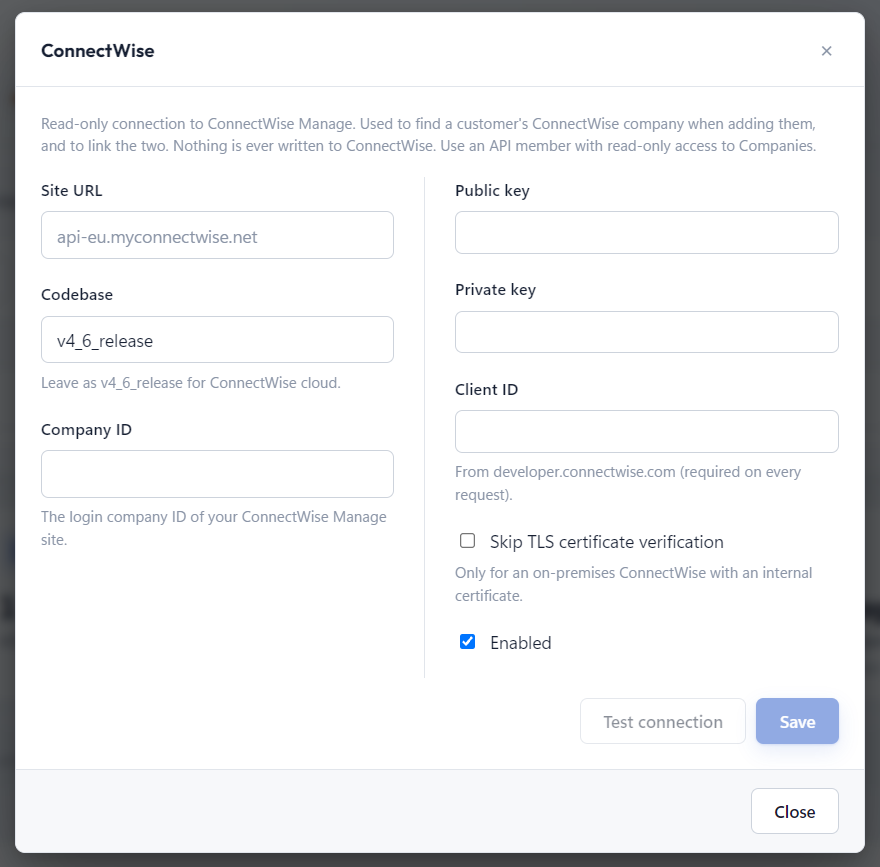

### Users, roles and two-factor authentication

**Users** (super admins only) manages the people who can sign in.

| Role | Access |
| --- | --- |
| Super Admin | Everything, including users, releases and report deletion approvals. |
| Admin | Customers, connectors, reports and settings. |
| Read Only | Customer information and reports only. |

- Everyone can turn on **two-factor authentication** from Settings. It uses any authenticator app and comes with one-time recovery codes.
- When creating a user you can **require** two-factor authentication. The user then has to set it up at the first sign-in and cannot turn it off.
- A super admin can reset another user's two-factor authentication from the Users page.

### Handy extras in the header

- **Search box**: type to find customers, connectors, vCenters, reports and vCenter logs. Click it while empty for quick actions and page shortcuts. Use the arrow keys and Enter.

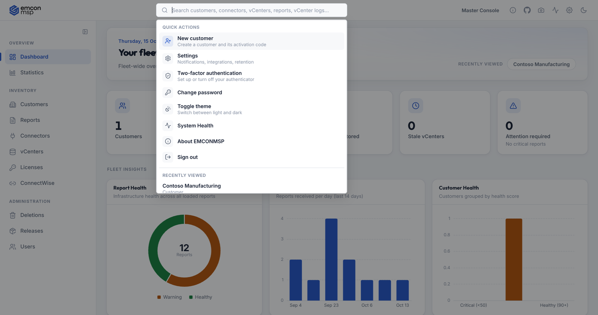
- **Camera icon**: save a screenshot of the full screen or of a selected area as a PNG.
- **Theme toggle** for light and dark mode.

---

## Using the Connector

The Connector has a small local web interface, reachable at its own address.

### Activate it

1. Sign in and change the initial password.
2. On the first screen, enter the **Master server URL** and the **activation code** you generated on the customer page of the Master.
3. The Connector shows *Active* and starts reporting.


### Add a vCenter

Use **Add vCenter** and fill in the vCenter address, a service account and the role it holds. **Test connection** and **Save** both check that the account can really sign in and has the privileges the Connector needs, so mistakes are caught immediately.

The service account only needs read access plus a few extra privileges. A **What role is needed?** button on the form lists the exact steps.

<p align="center">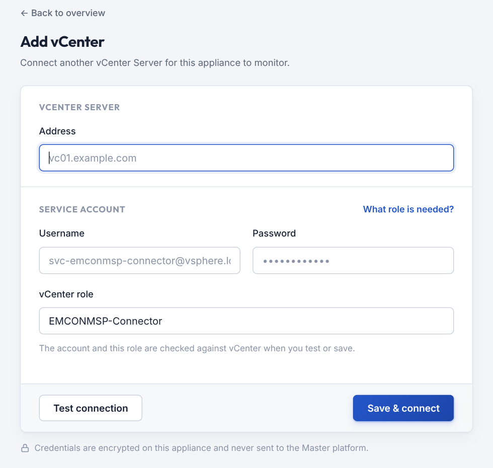 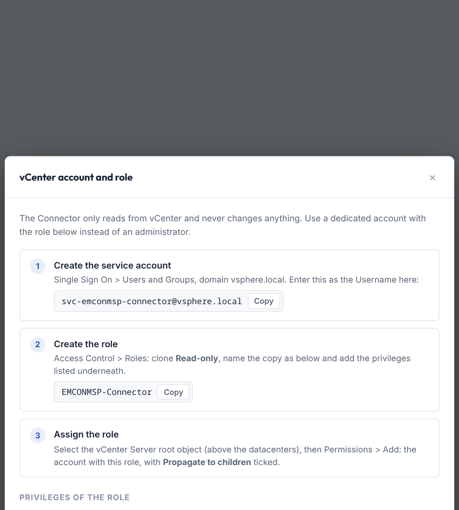</p>

| Privilege | Used for |
| --- | --- |
| Read-only role (System > View, System > Read) | Browsing the inventory and reading configuration. |
| Global > Licenses | License editions, usage and expiry. |
| Datastore > Browse datastore | Finding unreferenced VMDK files. |
| Host > Configuration > Change settings | Reading host settings such as NTP, syslog and shell timeouts. |

Create the role on the vCenter root with **Propagate to children** ticked. The default role name is `EMCONMSP-Connector`.

### Overview page

The overview shows the Connector state, the last and next synchronization, and every vCenter with its connection state, last report and collector health. The page refreshes itself. Use the pencil icon to edit a vCenter and **Add vCenter** to connect another one.

### Settings

The gear icon in the header offers **Change password**, **Network settings** (IP, DNS, NTP) and **Delete all reports**, which sends a deletion request that a super admin on the Master must approve.

<p align="center">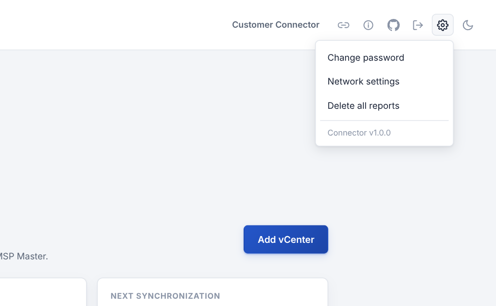</p>

Sessions end after 15 minutes without activity.

---

## Security at a glance

- Read-only access to vCenter, with a dedicated least-privilege service account.
- vCenter credentials are encrypted on the Connector and never leave it.
- Connectors only make outbound HTTPS calls to the Master.
- Role-based access on the Master, and optional or enforced two-factor authentication.
- Designed to work in closed networks without internet access.

## License

EMCONMSP is proprietary software. The license agreement is shown during OVA deployment and must be accepted before the appliance can be deployed.

&copy; PilotHosts Software and Technology Limited Company. A [Pilothosts Tech](https://www.pilothosts.com/) product.
